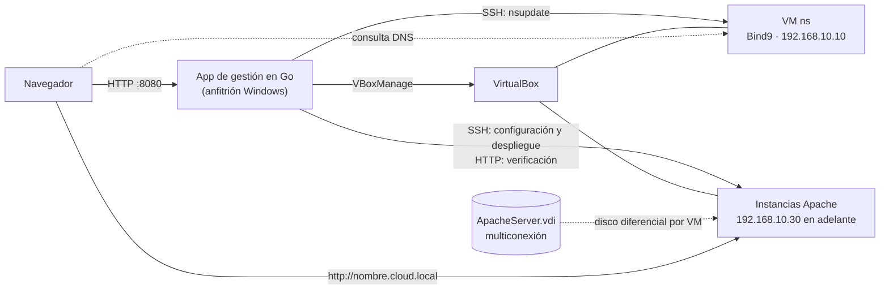

# httpaas-go

Servicio administrado de publicación temporal de páginas y aplicaciones web (**HTTPaaS**) sobre infraestructura virtualizada local con **Oracle VirtualBox**, **Apache HTTP Server** y **Bind9**.

Esta aplicación web, desarrollada en **Go**, es el punto de acceso para los usuarios y el orquestador de la infraestructura: crea máquinas virtuales a partir de un disco plantilla en modo multiconexión, les asigna nombre e IP, las registra en el DNS, despliega el contenido web y supervisa su estado.

> Proyecto de la asignatura **Computación en la Nube 2026-2**, Universidad del Quindío (Nota parcial #3: HTTP como servicio).
>
> Integrantes: Angelica María Reyes, Andrés Felipe Zambrano

## Funcionalidades

- **Desplegar una aplicación**: nombre del host + archivo `.zip` (opcional). Crea la VM, configura hostname e IP, registra el nombre en `cloud.local` y publica el contenido.
- **Progreso en vivo** del despliegue, etapa por etapa, con pantallas de éxito y de error, y **reintento** sin volver a subir el archivo.
- **Publicar** contenido en una instancia existente (reemplaza el sitio actual).
- **Dashboard** con instancias activas, IPs libres y estado de la infraestructura (DNS, SSH a `ns`, VirtualBox), verificado periódicamente.
- **Encender, apagar y reiniciar** instancias y el servidor DNS desde la interfaz.
- **Eliminar** instancias: apaga y borra la VM, quita el registro DNS y libera la IP.
- Interfaz responsive, actualizada en vivo sin recargar la página.
- **Trazabilidad**: cada solicitud, acción y cambio de estado queda en el log.

Los dos flujos del enunciado están cubiertos:

| Enunciado | En la app |
|---|---|
| Botón **Aceptar** (crear la instancia) | *Desplegar aplicación* sin archivo |
| Botón **Publicar** (desplegar el `.zip`) | Botón *Publicar* en la fila de la instancia |
| Ambos en un paso | *Desplegar aplicación* con archivo |

## Arquitectura



- **Red**: solo anfitrión `192.168.10.0/24` sin DHCP; el anfitrión es `192.168.10.1`. Cada VM tiene NAT en el adaptador 1 (`enp0s3`) y la red solo anfitrión en el adaptador 2 (`enp0s8`).
- **ns**: Bind9 con la zona `cloud.local`. La app actualiza la zona ejecutando `nsupdate` por SSH con la clave TSIG, que nunca sale de `ns`.
- **Plantilla**: Debian 13 (CLI) con Apache. Su disco está en modo **multiconexión**: cada instancia escribe en su propio disco diferencial y la plantilla queda intacta.
- **Usuario `deploy`**: acceso solo por llave SSH, con permisos mínimos (en `ns`, `sudo` solo para `nsupdate`; en las instancias, solo para el script de configuración).

### Flujo de aprovisionamiento

1. Validar el nombre del host y el `.zip`, y reservar la siguiente IP libre (`.30`, `.31`…).
2. Crear la VM con `VBoxManage` y conectar el disco multiconexión.
3. Esperar a que responda por SSH en la **IP temporal** `192.168.10.20`, con la que arranca toda VM clonada.
4. Ejecutar `configurar-instancia.sh`, que asigna hostname e IP definitivos y reinicia la VM.
5. Esperar a que responda en la IP definitiva.
6. Registrar el nombre en Bind9.
7. Publicar el contenido: el `.zip` se envía por SSH y se descomprime en `/var/www/html`.
8. Verificar que Apache responda por HTTP.

Si una etapa falla, se deshacen las anteriores (VM, registro DNS e IP). Las instancias se crean de a una, porque todas comparten la IP temporal.

## Requisitos

- Windows 10/11 con **Go 1.22 o superior**.
- **Oracle VirtualBox 7**.
- Cliente **OpenSSH** de Windows (`C:\Windows\System32\OpenSSH\ssh.exe`, incluido en Windows).
- **Git Bash** (recomendado para los comandos de este documento).
- La infraestructura preparada: VM `ns` importada, disco plantilla en multiconexión y la llave SSH del usuario `deploy` (ver siguiente sección).

## Preparar la infraestructura

Resumen; el detalle está en la guía de importación del equipo.

1. **Red solo anfitrión** `192.168.10.1/24` sin DHCP (en PowerShell como administrador):

   ```powershell
   $vbm = "C:\Program Files\Oracle\VirtualBox\VBoxManage.exe"
   & $vbm hostonlyif create
   & $vbm hostonlyif ipconfig "VirtualBox Host-Only Ethernet Adapter #2" --ip 192.168.10.1 --netmask 255.255.255.0
   ```

2. **VM `ns`**: importar el `.ova`, adaptador 1 en NAT, adaptador 2 en la red anterior, y arrancar solo desde el disco:

   ```bash
   VBOX="/c/Program Files/Oracle/VirtualBox/VBoxManage.exe"
   "$VBOX" modifyvm "debian ns" --nic1 nat --nic2 hostonly --hostonlyadapter2 "VirtualBox Host-Only Ethernet Adapter #2"
   "$VBOX" modifyvm "debian ns" --boot1 disk --boot2 none --boot3 none --boot4 none
   "$VBOX" startvm "debian ns" --type headless
   ```

3. **Disco plantilla** en `C:\HTTPaaS\ApacheServer.vdi`, convertido a multiconexión mediante una VM "ancla" que se deja **apagada y registrada** (mientras exista, VirtualBox recuerda el tipo del disco):

   ```bash
   "$VBOX" createvm --name ancla-plantilla --ostype Debian_64 --register
   "$VBOX" storagectl ancla-plantilla --name SATA --add sata --controller IntelAhci
   "$VBOX" storageattach ancla-plantilla --storagectl SATA --port 0 --device 0 --type hdd --medium 'C:\HTTPaaS\ApacheServer.vdi'
   "$VBOX" storageattach ancla-plantilla --storagectl SATA --port 0 --device 0 --medium none
   "$VBOX" modifymedium disk 'C:\HTTPaaS\ApacheServer.vdi' --type multiattach
   "$VBOX" storageattach ancla-plantilla --storagectl SATA --port 0 --device 0 --type hdd --medium 'C:\HTTPaaS\ApacheServer.vdi'
   ```

4. **Llave SSH** sin passphrase; la pública se instala en `ns` y en la plantilla para el usuario `deploy`:

   ```bash
   ssh-keygen -t ed25519 -f ~/.ssh/httpaas -C "httpaas-go"
   ```

5. **Resolver `cloud.local` desde Windows** (PowerShell como administrador). Windows reserva `.local` para mDNS; esta regla envía solo ese dominio a `ns`:

   ```powershell
   Add-DnsClientNrptRule -Namespace ".cloud.local" -NameServers "192.168.10.10"
   ```

## Ejecución

Desde **Git Bash abierto como administrador** (necesario para limpiar la caché ARP de Windows; ver *Limitaciones conocidas*):

```bash
cd httpaas-go
export HTTPAAS_HOSTONLY_IF="VirtualBox Host-Only Ethernet Adapter #2"
go run .
```

Abrir <http://localhost:8080>. El log de arranque muestra la configuración y advierte si falta VBoxManage, el disco o la llave.

Para guardar el log en un archivo:

```bash
go run . 2>&1 | tee app.log
grep -a "\[estado\]" app.log
```

Para compilar un ejecutable:

```bash
go build -o httpaas.exe .
```

## Configuración

Todos los valores tienen un predeterminado y se pueden cambiar con variables de entorno:

| Variable | Predeterminado | Descripción |
|---|---|---|
| `HTTPAAS_ADDR` | `:8080` | Dirección donde escucha la app |
| `HTTPAAS_DATA_FILE` | `data/instances.json` | Registro de instancias; los `.zip` pendientes van en `data/uploads/` |
| `HTTPAAS_VBOXMANAGE` | `C:\Program Files\Oracle\VirtualBox\VBoxManage.exe` | Ejecutable de VirtualBox |
| `HTTPAAS_TEMPLATE_DISK` | `C:\HTTPaaS\ApacheServer.vdi` | Disco plantilla en multiconexión |
| `HTTPAAS_HOSTONLY_IF` | `VirtualBox Host-Only Ethernet Adapter` | Adaptador de la red `192.168.10.0/24` |
| `HTTPAAS_NS_VM` | `debian ns` | Nombre de la VM del servidor DNS en VirtualBox |
| `HTTPAAS_SSH` | `C:\Windows\System32\OpenSSH\ssh.exe` | Cliente SSH |
| `HTTPAAS_SSH_USER` | `deploy` | Usuario remoto |
| `HTTPAAS_SSH_KEY` | `~/.ssh/httpaas` | Llave privada |
| `HTTPAAS_TEMPLATE_IP` | `192.168.10.20` | IP con la que arranca toda VM clonada |
| `HTTPAAS_DNS_SERVER` | `192.168.10.10` | IP de `ns` |

Valores fijos en el código: rango de IPs `192.168.10.30`–`192.168.10.254`, 512 MB y 1 CPU por VM, TTL de 300 s para los registros DNS, verificación de la infraestructura cada 5 s (cada 3 s durante transiciones o fallas).

## Estructura del proyecto

```
.
├── main.go, config.go     # arranque y configuración
├── internal/
│   ├── instance/          # registro de instancias en JSON y asignación de IPs
│   ├── vbox/              # comandos de VBoxManage
│   ├── remote/            # cliente SSH (comandos y envío de archivos)
│   ├── dns/               # registros A en Bind9 con nsupdate
│   ├── hostnet/           # limpieza de la caché ARP del anfitrión
│   ├── provision/         # orquestación de la creación y eliminación de VMs
│   ├── deploy/            # validación y despliegue del .zip
│   ├── deployment/        # despliegues en segundo plano, con estado y reintento
│   ├── health/            # verificación periódica y registro de cambios de estado
│   ├── power/             # encender, apagar y reiniciar VMs
│   └── web/               # handlers HTTP y vistas
├── templates/             # plantillas HTML (layout, partes y páginas)
├── static/                # CSS, JavaScript e íconos
└── ejemplos/              # sitios de prueba (paisajes y negocios)
```

Solo usa la biblioteca estándar de Go: sin frameworks web ni dependencias externas.

## Rutas

| Método | Ruta | Descripción |
|---|---|---|
| `GET` | `/` | Dashboard |
| `GET` | `/instances` | Lista de instancias |
| `GET` | `/deploy` | Formulario de despliegue |
| `POST` | `/deploy` | Crea la instancia y, si hay `.zip`, lo publica |
| `GET` | `/deployments/{id}` | Progreso, éxito o error de un despliegue |
| `POST` | `/deployments/{id}/retry` | Reintenta un despliegue fallido |
| `POST` | `/instances/{hostname}/publish` | Publica un `.zip` en una instancia existente |
| `POST` | `/instances/{hostname}/power/{start,stop,restart}` | Enciende, apaga o reinicia una instancia |
| `POST` | `/instances/{hostname}/delete` | Elimina una instancia |
| `POST` | `/infrastructure/ns/power/{start,restart}` | Enciende o reinicia `ns` |
| `GET` | `/api/deployments/{id}` | Estado de un despliegue en JSON |
| `GET` | `/api/status` | Estado de las instancias, la infraestructura y `ns` en JSON |

## Pruebas

```bash
go test ./...
```

Las pruebas no necesitan VirtualBox ni las VMs: los comandos externos (VBoxManage, SSH, nsupdate) se reemplazan por versiones falsas, y las páginas se prueban con `httptest` sobre las plantillas reales.

## Sitios de prueba

Los `.zip` deben tener `index.html` en la raíz. Para generarlos desde PowerShell:

```powershell
Compress-Archive -Path ejemplos\paisajes\* -DestinationPath paisajes.zip -Force
Compress-Archive -Path ejemplos\negocios\* -DestinationPath negocios.zip -Force
```

## Limitaciones conocidas

- **Caché ARP de Windows**: todas las VMs arrancan con la misma IP temporal (y las IPs se reutilizan al eliminar), cada una con una MAC distinta. Windows conserva la MAC anterior y la VM nueva queda inalcanzable; la app borra esa entrada con `arp -d`, que requiere ejecutarla como administrador.
- **Una instancia a la vez**: por la IP temporal compartida, los aprovisionamientos se encolan.
- **Llaves de host compartidas**: todas las instancias salen del mismo disco y comparten la llave de host SSH, por lo que la app no verifica las llaves de host.
- **Estado de los despliegues en memoria**: si la app se reinicia durante un despliegue, se pierde su seguimiento (las instancias ya creadas siguen en el registro).
- **Tiempos**: crear una instancia tarda unos 2-3 minutos, dominados por los dos arranques de Debian (antes y después de configurar la IP).
- **Reinicio del anfitrión**: las VMs quedan apagadas; se encienden desde la interfaz (`ns` con *Encender ns* en el dashboard).
- **Caché del navegador**: si se abrió una instancia antes de publicar, el navegador puede mostrar la página por defecto de Apache; se resuelve con `Ctrl+F5`.
